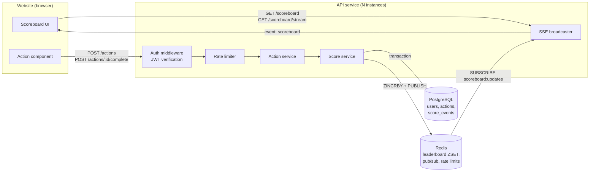
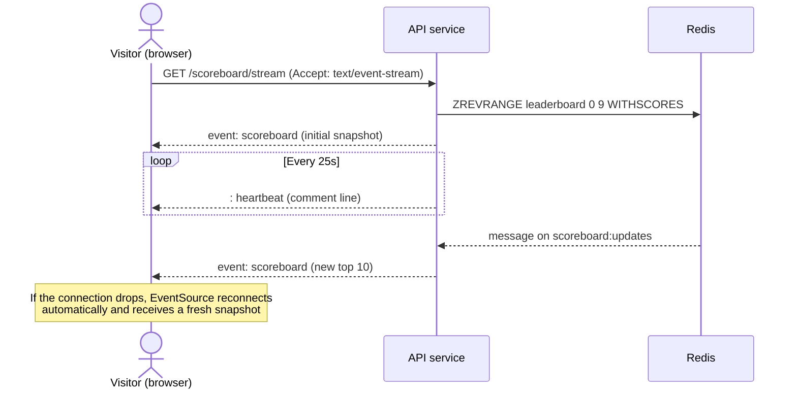

# Problem 6 — Live Scoreboard Module (Specification)

This document specifies the **Scoreboard module** of the API service. It is written for the backend engineering team that will implement it.

The module has three jobs:

1. **Accept score updates** when a user completes an action, but only if the update is authorised and genuine.
2. **Serve the top 10** users by score.
3. **Push live updates** of the top 10 to every connected website client whenever it changes.

---

## 1. Requirements recap

| # | Requirement                                                              | How this spec addresses it                                         |
| - | ------------------------------------------------------------------------ | ------------------------------------------------------------------ |
| 1 | Website shows a scoreboard with the top 10 users                         | `GET /scoreboard` + Redis sorted set (§4, §5)                      |
| 2 | Scoreboard updates live                                                  | Server-Sent Events stream `GET /scoreboard/stream` (§4.3, §6)      |
| 3 | User completes an action, which increases their score                    | Two-step action flow: start, then complete (§4.1, §4.2)            |
| 4 | Completing the action dispatches an API call to update the score         | `POST /actions/:actionId/complete` (§4.2)                          |
| 5 | Prevent malicious users from increasing scores without authorisation     | Auth + server-issued single-use action tickets + rate limits (§7)  |

### Core principle

**The client never tells the server how many points to add.** The client only reports *"I completed action X"*. The server decides whether that claim is valid and how many points it is worth. A request like `POST /score { "increment": 1000 }` must never exist.

---

## 2. Architecture overview



- **PostgreSQL** is the source of truth: users, issued actions, and an append-only ledger of score changes.
- **Redis** holds the leaderboard as a sorted set (`ZSET`), so reading the top 10 is fast (`O(log N)`). It also provides pub/sub, which lets every API instance learn about changes, and stores rate-limit counters.
- **SSE (Server-Sent Events)** pushes updates to browsers. Updates only flow from server to client, so SSE is simpler than WebSockets. It runs over plain HTTP and reconnects automatically.

---

## 3. Execution flow

### 3.1 Score update (happy path and rejections)

```mermaid
sequenceDiagram
    autonumber
    actor U as User (browser)
    participant API as API service
    participant DB as PostgreSQL
    participant R as Redis
    participant O as Other clients (SSE)

    U->>API: POST /actions  (Authorization: Bearer JWT)
    API->>API: Verify JWT, check rate limit
    API->>DB: INSERT action (id, user_id, status=PENDING, expires_at)
    API-->>U: 201 { actionId, expiresAt }

    Note over U: User performs the action

    U->>API: POST /actions/{actionId}/complete<br/>(Bearer JWT, Idempotency-Key)
    API->>API: Verify JWT, check rate limit
    API->>DB: BEGIN; SELECT action FOR UPDATE

    alt Action missing, owned by another user, expired, or already completed
        API->>DB: ROLLBACK
        API-->>U: 403 / 404 / 409 / 410
    else Completed faster than the minimum allowed duration
        API->>DB: Mark action REJECTED, log suspicious event; COMMIT
        API-->>U: 422 ACTION_TOO_FAST
    else Valid
        API->>DB: UPDATE action SET status=COMPLETED
        API->>DB: INSERT score_event (+points)
        API->>DB: UPDATE users SET score = score + points
        API->>DB: COMMIT
        API->>R: ZINCRBY leaderboard points user_id
        API->>R: Compare new top 10 with cached top 10
        opt Top 10 changed
            API->>R: PUBLISH scoreboard:updates {top10}
            R-->>API: (all instances) message
            API-->>O: SSE event: scoreboard {top10}
        end
        API-->>U: 200 { score, rank }
    end
```

### 3.2 Live scoreboard subscription



---

## 4. API specification

All endpoints are prefixed with `/api/v1`. Errors use the same shape as the rest of the API service:

```json
{ "error": { "code": "ACTION_EXPIRED", "message": "Action has expired" } }
```

### 4.1 `POST /actions` — start an action

Asks the server for a single-use **action ticket** before the user starts the action.

- **Auth:** required (`Authorization: Bearer <JWT>`)
- **Body:** `{ "type": "string" }`. The action type must exist in the server-side action catalogue (§5.4).
- **Response `201`:**

```json
{
  "actionId": "01J9Z6Q4V8K2M3N4P5R6S7T8U9",
  "type": "daily_quiz",
  "expiresAt": "2026-10-19T10:35:00.000Z"
}
```

| Status | Code                  | When                                          |
| ------ | --------------------- | --------------------------------------------- |
| 400    | `VALIDATION_ERROR`    | Unknown or missing `type`                     |
| 401    | `UNAUTHENTICATED`     | Missing, invalid, or expired JWT              |
| 409    | `TOO_MANY_PENDING`    | User already has the maximum number of pending actions (default 3) |
| 429    | `RATE_LIMITED`        | Rate limit exceeded                           |

### 4.2 `POST /actions/:actionId/complete` — complete an action and update the score

This is the API call the client sends once the action is complete.

- **Auth:** required
- **Headers:** `Idempotency-Key: <uuid>`. This is recommended. Retries that reuse the same key get the original response back.
- **Body:** `{}`, or an action-specific proof payload if the action type requires one (for example a quiz answer that the server checks). The body **must not** contain a score or an increment. Unknown fields are rejected with `400`.
- **Response `200`:**

```json
{ "userId": "u_123", "awarded": 10, "score": 1540, "rank": 4 }
```

| Status | Code                  | When                                                    |
| ------ | --------------------- | ------------------------------------------------------- |
| 401    | `UNAUTHENTICATED`     | Missing or invalid JWT                                  |
| 403    | `FORBIDDEN`           | The action belongs to a different user                  |
| 404    | `ACTION_NOT_FOUND`    | Unknown `actionId`                                      |
| 409    | `ACTION_ALREADY_USED` | Action is already `COMPLETED` or `REJECTED`             |
| 410    | `ACTION_EXPIRED`      | Current time is later than `expires_at`                 |
| 422    | `ACTION_TOO_FAST`     | Completed sooner than the action type's `min_duration`  |
| 422    | `INVALID_PROOF`       | Proof payload failed server-side verification           |
| 429    | `RATE_LIMITED`        | Rate limit exceeded                                     |

### 4.3 `GET /scoreboard` — top 10 snapshot

- **Auth:** not required (public)
- **Response `200`:**

```json
{
  "updatedAt": "2026-10-19T10:30:12.345Z",
  "entries": [
    { "rank": 1, "userId": "u_42", "displayName": "alice", "score": 9800 },
    { "rank": 2, "userId": "u_7",  "displayName": "bob",   "score": 9750 }
  ]
}
```

Users with equal scores are ordered by who reached the score first (see §5.3).

### 4.4 `GET /scoreboard/stream` — live updates (SSE)

- **Auth:** not required (public)
- **Response:** `Content-Type: text/event-stream`
- Sends the current snapshot as soon as the client connects, then sends a new event each time the top 10 changes:

```
event: scoreboard
id: 1729333812345
data: {"updatedAt":"2026-10-19T10:30:12.345Z","entries":[...]}

: heartbeat
```

- A comment line (`: heartbeat`) is sent every 25 s so that proxies and load balancers don't close idle connections.
- Broadcasts are **throttled to at most 1 per second per instance**. Every broadcast carries the latest state, so dropping intermediate updates is safe.
- Client usage: `new EventSource("/api/v1/scoreboard/stream")`.

### 4.5 `GET /users/me/score` — current user's score and rank (optional)

- **Auth:** required
- **Response `200`:** `{ "score": 1540, "rank": 37 }`. Rank comes from `ZREVRANK`.

---

## 5. Data model

### 5.1 PostgreSQL

```sql
CREATE TABLE users (
  id              TEXT PRIMARY KEY,
  display_name    TEXT NOT NULL,
  score           BIGINT NOT NULL DEFAULT 0,
  score_updated_at TIMESTAMPTZ NOT NULL DEFAULT now()
);

CREATE TABLE actions (
  id           TEXT PRIMARY KEY,                 -- ULID, unguessable
  user_id      TEXT NOT NULL REFERENCES users(id),
  type         TEXT NOT NULL,
  status       TEXT NOT NULL CHECK (status IN ('PENDING','COMPLETED','REJECTED','EXPIRED')),
  created_at   TIMESTAMPTZ NOT NULL DEFAULT now(),
  expires_at   TIMESTAMPTZ NOT NULL,
  completed_at TIMESTAMPTZ
);
CREATE INDEX actions_user_pending ON actions (user_id) WHERE status = 'PENDING';

-- Append-only ledger: every score change is recorded and can be audited or replayed.
CREATE TABLE score_events (
  id          BIGSERIAL PRIMARY KEY,
  user_id     TEXT NOT NULL REFERENCES users(id),
  action_id   TEXT NOT NULL UNIQUE REFERENCES actions(id),  -- one award per action, enforced by the DB
  points      INTEGER NOT NULL CHECK (points > 0),
  created_at  TIMESTAMPTZ NOT NULL DEFAULT now()
);
```

### 5.2 Redis keys

| Key                          | Type    | Purpose                                                  |
| ---------------------------- | ------- | -------------------------------------------------------- |
| `leaderboard`                | ZSET    | member = `user_id`, score = composite score (see §5.3)   |
| `leaderboard:top10`          | STRING  | Cached JSON of the last broadcast top 10, used to detect changes |
| `scoreboard:updates`         | Pub/Sub | Channel for broadcasting top 10 changes to all instances |
| `ratelimit:{userId}:{route}` | STRING  | Sliding-window or token-bucket counters                  |
| `idem:{userId}:{key}`        | STRING  | Cached response for an idempotency key (TTL 24 h)        |

### 5.3 Tie-breaking

To rank users with equal scores by who reached the score first, store a composite value in the ZSET:

```
zsetScore = score * 1e10 + (MAX_TS - score_updated_at_epoch_seconds)
```

Alternatively, keep plain scores in the ZSET and resolve ties when reading from Postgres. Either approach is acceptable, but the team must pick one and apply it consistently.

### 5.4 Action catalogue (server-side config)

```ts
interface ActionType {
  type: string;          // e.g. "daily_quiz"
  points: number;        // points awarded on success, defined ONLY on the server
  minDurationMs: number; // completions faster than this are rejected
  ttlMs: number;         // how long the ticket stays valid
  dailyCap?: number;     // max completions per user per day
}
```

---

## 6. Live update details

1. Once the database transaction for a completion commits, the score service runs `ZINCRBY leaderboard <points> <userId>`.
2. It reads `ZREVRANGE leaderboard 0 9 WITHSCORES` and compares the result with `leaderboard:top10`.
3. If the top 10 changed (membership, order, or any score), it stores the new value and runs `PUBLISH scoreboard:updates <json>`. Steps 2 and 3 should run as a single Lua script so they are atomic.
4. Every API instance subscribes to `scoreboard:updates` and writes the event to all of its open SSE connections, throttled as described in §4.4.

Most score updates don't change the top 10, so most of them trigger no broadcast. This keeps fan-out cheap.

**Consistency:** Postgres is authoritative. If the Redis write fails after the commit, log the error and let the reconciliation job fix it. The job runs every minute (configurable) and rebuilds the ZSET from `users.score`. Redis can also be rebuilt from scratch on startup.

---

## 7. Security: preventing unauthorised score increases

| Threat                                                | Mitigation                                                                                          |
| ----------------------------------------------------- | --------------------------------------------------------------------------------------------------- |
| Anonymous calls to the update endpoint                | JWT required. Verify signature, `exp`, `iss`, and `aud`. The user id comes **only** from the token, never from the body. |
| Client sends an inflated score                        | The request has no score field. Points come from the server-side action catalogue.                  |
| Replaying a valid completion request                  | Single-use ticket: `SELECT … FOR UPDATE` plus a status check, and `score_events.action_id UNIQUE` as a database-level guarantee. |
| Using another user's ticket                           | The action's `user_id` must match the JWT subject, otherwise `403`.                                 |
| Calling `/complete` without doing the action (scripted) | `minDurationMs` check, ticket TTL, optional server-verified proof payload, and per-type daily caps. |
| Flooding start or complete requests                   | Per-user and per-IP rate limits (default: 10 starts/min, 10 completes/min per user), plus a cap on pending tickets. |
| Guessing action IDs                                   | IDs are ULIDs or UUIDv4 (≥ 122 bits of randomness) and are checked against their owner.            |
| Network retries double-counting                       | `Idempotency-Key` header, and the ticket can only be completed once.                                |
| Token theft                                           | HTTPS only, short-lived access tokens (≤ 15 min) with refresh tokens, and CORS restricted to the website origin. |

Every rejected completion (`403`, `409`, `410`, `422`) is logged with user id, IP, and reason, and counted in metrics so abuse can be detected (§8).

---

## 8. Non-functional requirements

- **Performance:** `POST /complete` p99 < 150 ms. `GET /scoreboard` p99 < 20 ms (served from Redis). A broadcast should reach clients within 1 s of the commit.
- **Scalability:** the API is stateless apart from open SSE connections, so it scales horizontally behind a load balancer. Redis pub/sub handles fan-out across instances. Set the load balancer's idle timeout above the heartbeat interval.
- **Observability:**
  - Metrics: completions per second, rejections by reason, SSE connection count, broadcast rate, Redis/Postgres latency.
  - Structured logs with a request id.
  - Alerts on spikes in rejections or on a single user's completion rate.
- **Testing:** the implementation must include tests for:
  - Unit: points lookup, tie-breaking, top-10 change detection.
  - Integration: full start → complete flow; replay returns `409`; expired ticket returns `410`; another user's ticket returns `403`; too-fast completion returns `422`; missing JWT returns `401`.
  - Concurrency: N parallel completes of the same ticket award points exactly once.
  - SSE: the client receives a snapshot on connect and an event after a top-10 change.

---

## 9. Suggested module layout

```
src/scoreboard/
├── action.catalogue.ts     # ActionType definitions (points, TTL, minDuration, caps)
├── action.repository.ts    # actions + score_events SQL
├── action.service.ts       # start / complete business rules
├── score.service.ts        # transaction, Redis ZINCRBY, top-10 diff + publish
├── leaderboard.cache.ts    # Redis ZSET reads, reconciliation job
├── scoreboard.stream.ts    # SSE connection registry, heartbeat, throttled broadcast
├── scoreboard.router.ts    # HTTP routes
└── scoreboard.schema.ts    # Zod request/response schemas
```

---

## 10. Improvements and open questions

These are suggestions for the team and product owner. They are not required for the first version.

1. **Make the action verifiable on the server.** The ticket flow makes cheating harder, but it cannot *prove* the user did the action if the action happens entirely in the browser. The strongest protection is for the server to judge the outcome itself, for example by checking quiz answers or validating a game replay. Product should confirm which actions can be verified this way.
2. **Move broadcasting out of the request path.** Put score events on a queue or stream (Redis Streams, Kafka) and have a separate worker update the leaderboard and broadcast. This keeps `/complete` fast and isolates failures. A transactional outbox table guarantees that no events are lost between Postgres and the queue.
3. **Anomaly detection.** Flag users whose completion rate or timing pattern is unusual (for example, perfectly regular intervals), and move them to a review queue or shadow-ban them instead of only applying hard rate limits.
4. **Bot protection.** Add a CAPTCHA or proof-of-work challenge on `POST /actions` when a user's risk score is high.
5. **Request signing or device attestation** (App Attest or Play Integrity for mobile clients) makes scripted clients harder to build. This adds friction, so weigh it against the benefit.
6. **Leaderboard scopes.** Daily, weekly, and all-time boards are easy to add with one ZSET per period (`leaderboard:2026-W43`) with a TTL.
7. **WebSockets instead of SSE**, if two-way messaging (chat, presence) is planned later. Otherwise SSE is enough.
8. **CDN or edge caching** for `GET /scoreboard` with a 1–2 s TTL, to absorb traffic spikes from anonymous visitors.
9. **Privacy.** Decide whether the public scoreboard shows real names or nicknames, and whether users can opt out.
10. **Score corrections.** Because `score_events` is an append-only ledger, admins can reverse fraudulent points by writing a compensating event and rebuilding the leaderboard. An admin endpoint for this should be specified separately.

### Open questions for product

- Are points fixed per action type, or do they vary (for example, based on performance)?
- Is there a daily or lifetime cap per user?
- Should users who are not logged in be able to see the scoreboard? (This spec assumes yes.)
- What should happen to the scores of banned users? Hide them from the board, or remove them entirely?
